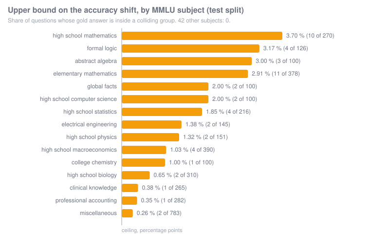
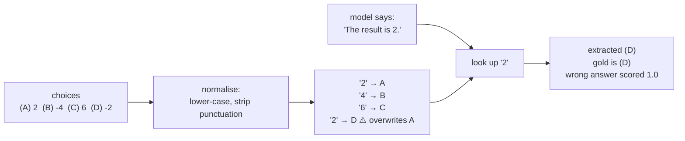

<div align="center">

# When "5" and "−5" are the same answer

**A census of real MMLU questions exposed to the choice-collision bug in `lm-evaluation-harness` ([#4509](https://github.com/EleutherAI/lm-evaluation-harness/issues/4509))**


-lightgrey)


</div>

---

## The finding in one paragraph

`MultiChoiceRegexFilter` normalises each answer choice (lower-case, punctuation removed) and keeps **one letter per normalised text**. If two choices collapse to the same text, such as `5` and `-5`, the last one silently takes the letter of both. The bug was reported in issue #4509, whose author noted that the number of real questions affected had not been counted.

This repository is that count. In MMLU, **51 test questions and 7 validation questions** have their correct answer inside a colliding group. The effect on the overall score is capped at **0.36 points**, but in **11 of 57 subjects** the cap exceeds one point.

> [!IMPORTANT]
> These are ceilings, not measured effects. No model was run. The bug only acts when a model answers with the choice text instead of the letter, and how often that happens was not measured.
>
> The bug and its fix belong to others (issue #4509, PR #4522). This repository only contributes the count.

## Key findings

| | `mmlu_flan_n_shot_generative` (test) | `mmlu_flan_cot_zeroshot` (validation) |
|---|---|---|
| Questions | 14,042 | 1,531 |
| With colliding choices | 82 | 8 |
| **Exposed** (gold answer inside the collision) | **51** | **7** |
| — a correct literal answer is scored wrong | 26 | 3 |
| — a wrong literal answer is scored right | 25 | 4 |
| Ceiling on overall accuracy | 0.363 points | 0.457 points |
| Subjects with a ceiling ≥ 1 point | 11 of 57 | 6 of 57 |
| Highest ceiling | 3.70 % — high school mathematics (10 of 270) | 9.09 % — college mathematics (1 of 11) |

<div align="center">

</div>

**What collides**, in the 51 exposed test questions:

| Kind | Count | Example |
|---|---|---|
| Numbers differing only by a minus sign or decimal point | 26 | `-19` / `19` · `156` / `15.6` |
| Other punctuation | 20 | `1.5 KV.` / `15 KV.` |
| Letter case only | 3 | `BB Bb` / `Bb Bb` (genetics) |
| Choices made only of symbols | 2 | `/` / `//` |

The two error directions are almost balanced (26 remove credit, 25 give it away), which is why the overall ceiling is low while per-subject ceilings in number-heavy subjects are not.

## How the bug works



The line responsible, at commit [`d6de8164`](https://github.com/EleutherAI/lm-evaluation-harness/blob/d6de81643928d653435c431bae19945d41d32520/lm_eval/filters/extraction.py):

```python
choice_to_alpha[m] = f"({next_alpha})"   # one letter per normalised text; the last choice wins
```

## Data you can use

| File | Contents |
|---|---|
| [`results/affected_questions.csv`](results/affected_questions.csv) | All 94 questions with colliding choices (test, validation, dev): subject, row, the four choices, gold, colliding groups, exposure type. Usable as regression cases |
| [`results/per_subject.csv`](results/per_subject.csv) | Counts and ceiling for each of the 57 subjects in each split |
| [`census/results/censo.json`](census/results/censo.json) | Raw census, including every output of the real filter on constructed answers |

## Controls

| Control | Result |
|---|---|
| The **unmodified** filter file from the pinned commit, run on constructed literal answers for every colliding question | 234 literal answers come out with the wrong letter, as the census predicts; 735 of 752 outputs match the prediction |
| The example from the issue (high school mathematics, validation, row 8) | Reproduced |
| Negative control: 500 random questions without collisions (2,000 choices) | 1,990–1,994 correct letters; the few misses are other defects, listed below |
| Independent audit with its own reader, normaliser and counter | Counts agree question by question; 193 checks, 0 failures |

### Two side observations (descriptive, not pre-registered)

1. **Choices that normalise to an empty string** (`/`, `//`, `**`) are never matched, so a literal answer falls through to the next fallback.
2. **Choices whose normalised text starts or ends with whitespace** (`. . . asthma.`, `'Rocky '`) are found by the regex and then lost by the `.strip()` before the dictionary lookup; the raw text is returned instead of a letter.

We have not checked whether these two are already reported.

## Reproduce

```bash
sh census/baja.sh                      # downloads the pinned filter, the task YAMLs and cais/mmlu (≈ 4 MB)
docker build -t pchoque:env census/
sh census/run.sh prueba                # synthetic tests, no exam data
sh census/run.sh censo                 # the census (slow: the real filter rebuilds a Unicode table on every call)
sh census/run.sh evalua
CHOQUE_SCRIPT=audit_choque1.py sh census/run.sh
```

Paths in the scripts assume this repository's `census/` folder is named `choque/` next to an `ext/` folder, as in the original project; see [`census/README.md`](census/README.md).

## Method

| Step | What was done |
|---|---|
| Protocol | Written and committed before any code or data ([`census/PROTOCOL_PCHOQUE1.md`](census/PROTOCOL_PCHOQUE1.md), in Spanish), including definitions, verdict rules and the author's prediction |
| Amendment | One, before opening the exam: which split each task evaluates, read from the task YAMLs |
| Freeze | SHA-256 of code, filter, YAMLs and data ([`census/config_frozen.json`](census/config_frozen.json)) |
| Run | One formal run |
| Audit | Independent script. **It failed on its first pass**: the audit's own short re-implementation mishandled choices that normalise to an empty string (29 of 1,504 outputs). The census counts already agreed question by question. The audit line was corrected after results were seen, and this is stated in the report |
| Verdict | Pre-registered rule: "may matter" when any subject's ceiling is ≥ 1 point. That is what came out, for both tasks |

## Limits

- A ceiling, not an effect: no model completions were scored.
- One benchmark (MMLU) and one code revision. GPQA and the task-local filter copies (BBH) were not examined.
- The behaviour of the proposed fix (PR #4522) on these 58 questions was not tested.
- Per-subject ceilings rest on few questions (3 to 10 per subject in test; validation subjects have 5 to 30 questions in total).
- One author, one run.

## Credits

- Bug report: issue [#4509](https://github.com/EleutherAI/lm-evaluation-harness/issues/4509) in `EleutherAI/lm-evaluation-harness`; proposed fix: PR [#4522](https://github.com/EleutherAI/lm-evaluation-harness/pull/4522). The mechanism and the fix are theirs.
- MMLU: Hendrycks et al., distributed as [`cais/mmlu`](https://huggingface.co/datasets/cais/mmlu) under the MIT license. The affected-question list reproduces answer choices from that dataset.
- Author: **Eli Saul Florez Perez** ([@elisaul77](https://github.com/elisaul77)).
- Analysis, code and writing were done with AI assistance (Claude; the direction came out of an independent review by Codex). All numbers come from the audited run.

## License

MIT for the code in this repository. See [`LICENSE`](LICENSE).
